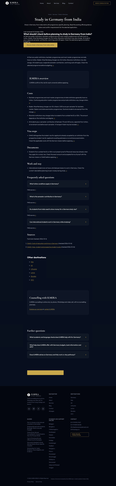
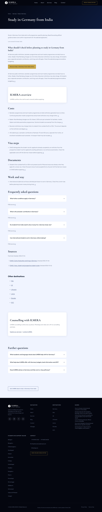
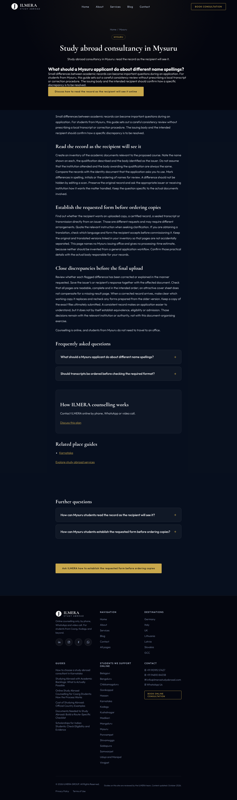
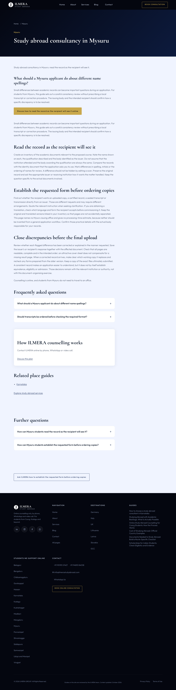
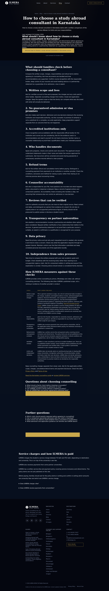
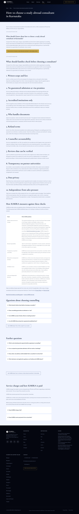
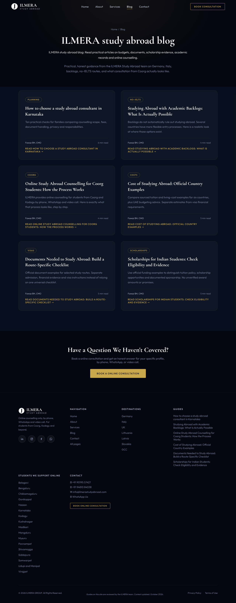
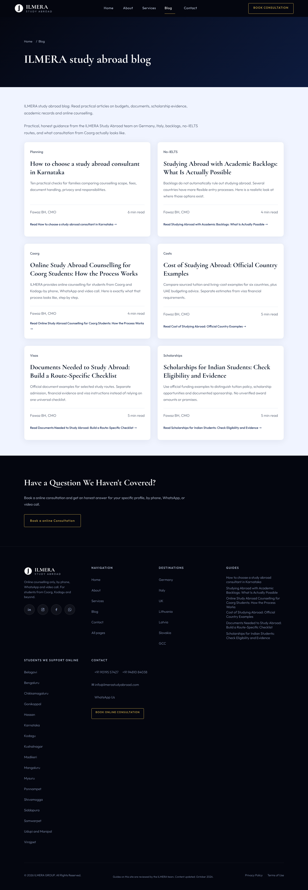

# Phase 25 pilot visual review

Stage 1 only. Four pilot routes, no rollout. All words, heading sequence, links, FAQs, JSON-LD, canonicals, sitemap/status data and original photos are protected by the all43-route guard. Home/About have only the authorized card-bio/team-area changes.

## Self-review outcomes

- Actual Cormorant/Outfit custom fonts verified through Chromium platform-font reporting, not only declared CSS or font-load status.
- First post-hero section and long reading areas are light; 70ch lane, left-aligned reference grid, restrained cards/tables/FAQ, no card/text hover motion.
- All24 JS-on/off viewport cases pass;126 FAQ expansions;12 axe runs, zero WCAG A/AA violations; keyboard/menu/Escape and44px targets pass. Explicit default/hover/focus palette contrast minimum5.11 against required4.5.
- Static responsive stills, no pilot WebGL/library/parallax. Save-Data zero image fetches; hidden deferred until resumed; reduced motion remains static; JS-off gradient readable.
- Equal-height cards preserve names/photos/crops/widths/titles/alt. Original team section rectangles are preserved at all three approval widths.

## Strict reference pixel result

**NOT fully cleared.** Eleven of twelve zero-tolerance reference comparisons pass. Home1280 retains9 different anti-aliased corner pixels on the existing navigation CTA, only one colour level per affected channel, after deterministic software/sRGB/no-motion/dither calibration. No threshold, broad mask, source change or copied image pixels were used to hide this. Keep the failing result visible for owner review; do not call it a full pixel PASS. Full source/render guards show no reference changes outside the explicit team exception. Evidence: [reference-pixels JSON](phase-25-reference-pixels.json).

All Services/Contact pixels and all About pixels outside its authorized team rectangle are exact at360/768/1280. Home360/768 outside team are exact. Home1280 is the9-pixel exception above. Both before and after show completed reference animation states; capture-only pre-paint no-motion, software compositing, sRGB and WebGL dither controls avoid transient/compositor differences. Final images are real viewport rasters stitched without editing content pixels.

## Pilot comparisons

### Germany destination

| Width | Before | After |
| --- | --- | --- |
| 360px | [Before](screenshots/phase-25/before-germany-360.png) | [After](screenshots/phase-25/after-germany-360.png) |
| 768px | [Before](screenshots/phase-25/before-germany-768.png) | [After](screenshots/phase-25/after-germany-768.png) |
| 1280px | [Before](screenshots/phase-25/before-germany-1280.png) | [After](screenshots/phase-25/after-germany-1280.png) |

### Mysuru place

| Width | Before | After |
| --- | --- | --- |
| 360px | [Before](screenshots/phase-25/before-mysuru-360.png) | [After](screenshots/phase-25/after-mysuru-360.png) |
| 768px | [Before](screenshots/phase-25/before-mysuru-768.png) | [After](screenshots/phase-25/after-mysuru-768.png) |
| 1280px | [Before](screenshots/phase-25/before-mysuru-1280.png) | [After](screenshots/phase-25/after-mysuru-1280.png) |

### Choosing-consultant article

| Width | Before | After |
| --- | --- | --- |
| 360px | [Before](screenshots/phase-25/before-article-360.png) | [After](screenshots/phase-25/after-article-360.png) |
| 768px | [Before](screenshots/phase-25/before-article-768.png) | [After](screenshots/phase-25/after-article-768.png) |
| 1280px | [Before](screenshots/phase-25/before-article-1280.png) | [After](screenshots/phase-25/after-article-1280.png) |

### Blog index

| Width | Before | After |
| --- | --- | --- |
| 360px | [Before](screenshots/phase-25/before-blog-360.png) | [After](screenshots/phase-25/after-blog-360.png) |
| 768px | [Before](screenshots/phase-25/before-blog-768.png) | [After](screenshots/phase-25/after-blog-768.png) |
| 1280px | [Before](screenshots/phase-25/before-blog-1280.png) | [After](screenshots/phase-25/after-blog-1280.png) |

## Reference screenshots

| Reference | 360px | 768px | 1280px |
| --- | --- | --- | --- |
| home | [Before](screenshots/phase-25/before-home-360.png) / [After](screenshots/phase-25/after-home-360.png) | [Before](screenshots/phase-25/before-home-768.png) / [After](screenshots/phase-25/after-home-768.png) | [Before](screenshots/phase-25/before-home-1280.png) / [After](screenshots/phase-25/after-home-1280.png) |
| services | [Before](screenshots/phase-25/before-services-360.png) / [After](screenshots/phase-25/after-services-360.png) | [Before](screenshots/phase-25/before-services-768.png) / [After](screenshots/phase-25/after-services-768.png) | [Before](screenshots/phase-25/before-services-1280.png) / [After](screenshots/phase-25/after-services-1280.png) |
| about | [Before](screenshots/phase-25/before-about-360.png) / [After](screenshots/phase-25/after-about-360.png) | [Before](screenshots/phase-25/before-about-768.png) / [After](screenshots/phase-25/after-about-768.png) | [Before](screenshots/phase-25/before-about-1280.png) / [After](screenshots/phase-25/after-about-1280.png) |
| contact | [Before](screenshots/phase-25/before-contact-360.png) / [After](screenshots/phase-25/after-contact-360.png) | [Before](screenshots/phase-25/before-contact-768.png) / [After](screenshots/phase-25/after-contact-768.png) | [Before](screenshots/phase-25/before-contact-1280.png) / [After](screenshots/phase-25/after-contact-1280.png) |

## Deviations and limits

Pilot-only nav/footer/link hit boxes are larger than their immutable reference equivalents to meet44px; the fixed pilot nav is opaque dark over light text sections. This preserves reference palette/fonts/content/grid, not a false pixel-clone claim for pilot chrome. No new styling is applied to any other template.

The missing-font article and optional-font fallback were corrected with small OFL same-family subsets embedded in existing inline CSS. Outfit retains its variable weights; Cormorant uses the exact700 role. Existing non-Latin/emoji system fallback is retained where the original Latin font has no glyph. No new design family or blocking font request.

Metrics are measured separately in task6; no performance clearance is claimed here. The native hosting/backup/layout/MIME/contact-delivery blockers remain unchanged.

## Task 6 final candidate supersedes the still/font-loading description above

All final after-images were reshot for the measured palette-gradient tier: zero scene-image or scene-script requests on all four pilots. Same-family font subsets stay embedded in existing CSS, with block display and an atomic two-face first-text paint gate (3s/error failsafe; JS-off never gets the pending class). This corrects partial-font shifts without adding font HTTP requests. Final matched-order performance medians pass all original limits; failed candidates are retained. See phase-25-stage-1-report.md and phase-25-pilot-gate.json. The9-pixel Home1280 reference raster blocker remains unresolved and zero tolerance remains unchanged.
